  

 

### about

- student dev who builds a bit of everything: **websites**, **games**,**discord bots**, **and more..**
- day-to-day stack is **Laravel + Blade + Tailwind + Vite**, with React / Next.js on the side
- making games in **Lua / Luau** and **Python/GDscript** (Love2D, Roblox, Godot, PyGame) and the browser
- currently working on my site **[spiyse.dev](https://spiyse.dev)** and a Roblox case-opening game

### stack

  

### activity

<b>coding heatmap</b> (via Hackatime)

 

  <a href="https://heatmap.shymike.dev/?id=9330&timezone=UTC&cell_size=100&standalone=true" title="Click to view detailed data for each day!">
    <picture>
      <source media="(prefers-color-scheme: dark)" srcset="https://heatmap.shymike.dev/?id=9330&timezone=UTC&cell_size=100&theme=dark">
      
    </picture>
  </a>

<b>languages</b>

 

  

 

goose, not duck.

